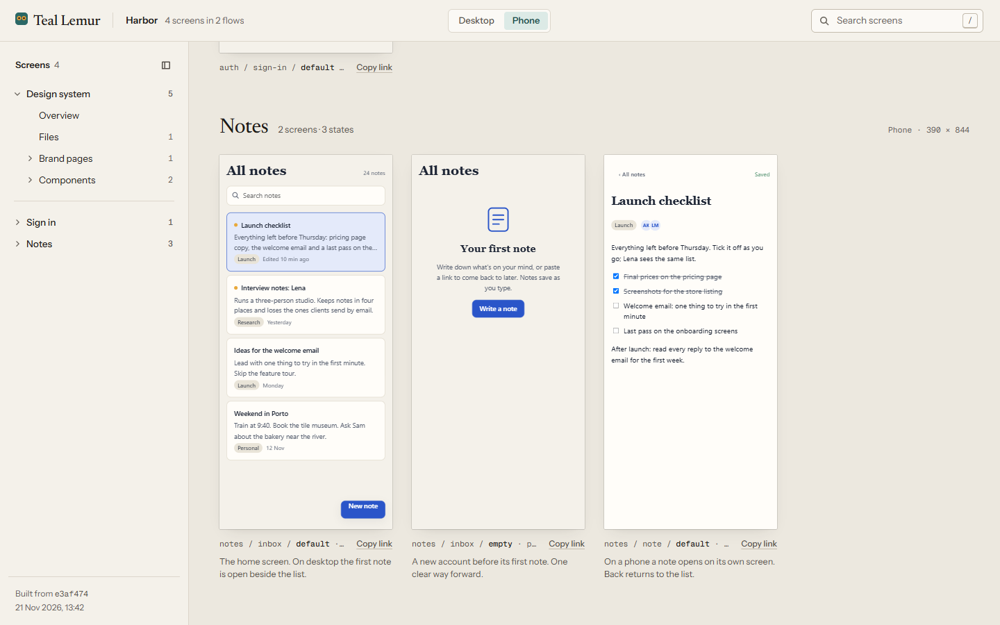
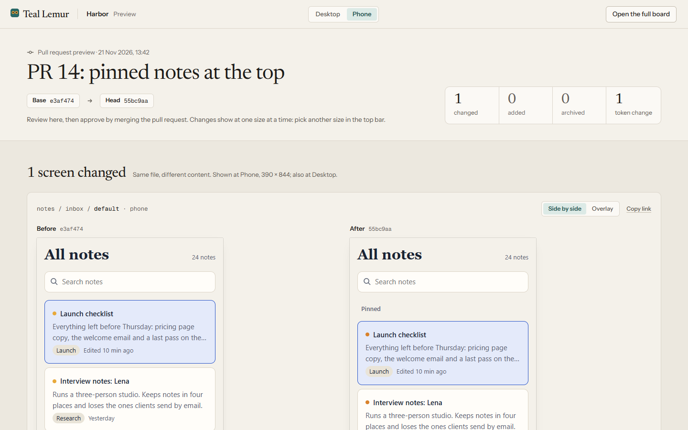
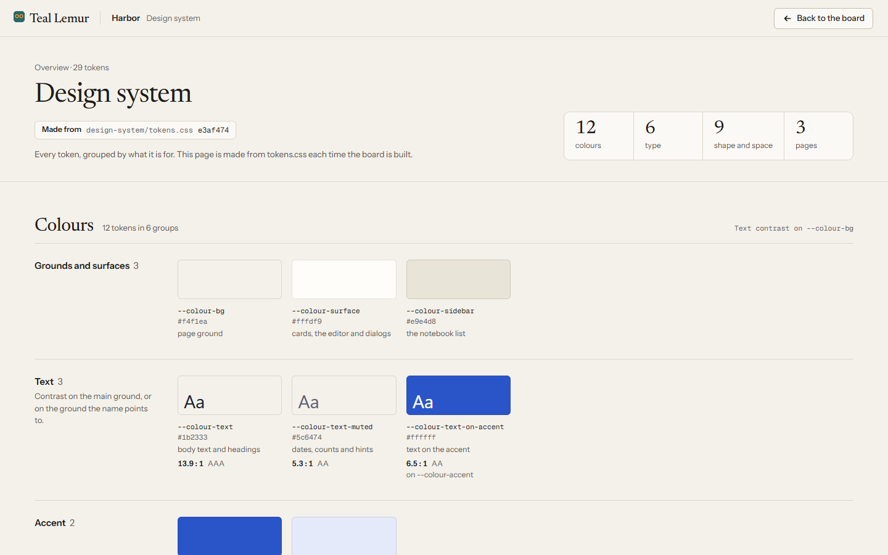

<p align="center">
  
</p>

<h1 align="center">Teal Lemur</h1>

<p align="center"><strong>Review design the way you review code.</strong></p>

<p align="center">
Keep your product's design in your own repository, as plain HTML and CSS.<br>
Teal Lemur checks it, lays every screen out on one board,<br>
and gives each change a before-and-after preview anyone can open.
</p>



## With Teal Lemur, your team

- **Always knows which design is current.** It's the one on `main`, next to
  the code, with its whole history in git. Nobody asks "is this the latest
  version?" again.
- **Approves design in a pull request.** Each change gets its own preview
  page. A founder, a client or a teammate opens it, compares before and after,
  and approves by merging. They don't need a design tool or an account.
- **Lets AI agents design without losing the style.** Agents already write
  good HTML and CSS. The check keeps them inside your design system: every
  colour and font comes from your tokens, and every screen sits where it
  belongs. Agents can read the [agent skill](skills/teallemur/SKILL.md) to
  learn the rules.
- **Owns all of it.** There's no lock-in and no server, and nothing tracks
  you. The output is static files you can host anywhere, and its pages load
  nothing from outside your own site.

## See every change before you approve it



Build a preview for a pull request, and Teal Lemur shows what changed, screen by
screen. It shows before and after side by side or as an overlay, along with
every token whose value changed.

## Your design system on one page



Teal Lemur reads your `tokens.css` and draws every colour, font, size and
spacing value. Each text colour shows its contrast ratio, so you can spot
unreadable text before anyone ships it.

## Try it in a minute

You need Node.js 24 or later. This builds the board for the example notes app:

```sh
git clone --depth 1 https://github.com/betalgo/teallemur.git
cd teallemur
npm ci                                              # installs and builds the tool
node dist/cli.js build examples/harbor --out site
python3 -m http.server 8000 --directory site        # or any static file server
```

Then open <http://localhost:8000/harbor/>.

## Use it on your own design

Add it to the project that holds your design. Pick the latest tag from the
[tags page](https://github.com/betalgo/teallemur/tags):

```sh
npm install --save-dev github:betalgo/teallemur#<tag>
```

```sh
npx teallemur check my-design                        # find problems, one per line
npx teallemur build my-design --out site             # write the board to site/<product>/
npx teallemur hub --out site --title "Our designs"   # one home page for every product in site/
```

To preview a pull request, build it with `--base` pointing at a checkout of
the base branch:

```sh
npx teallemur build my-design --base base-checkout --out site --label "PR 14: pinned notes"
```

`check` says exactly what's wrong and where:

```text
screens/_shared/app.css:145: tokens/colour-literal: colour literal "#2a55c9" outside design-system/tokens.css; use a var(--...) token
screens/notes/inbox--empty.html:1: html/missing-title: page has no <title>
teallemur: 2 errors
```

## A design repo is just files

```text
design.json                          the product's name, screen sizes and flows
design-system/tokens.css             every colour, font and size, in one file
design-system/components.css         shared styles, built from the tokens
design-system/components/button.html one page per component
screens/notes/inbox--default.html    one HTML file per screen and state
screens/notes/inbox--empty.html
```

A screen is a normal web page that uses your tokens and components:

```html
<!doctype html>
<html lang="en">
<head>
  <meta charset="utf-8">
  <title>Inbox · empty</title>
  <meta name="design:note" content="A new account before its first note.">
  <link rel="stylesheet" href="../../design-system/tokens.css">
  <link rel="stylesheet" href="../../design-system/components.css">
</head>
<body>
  <h1>Your first note</h1>
  <a class="button button--primary" href="note--default.html">Write a note</a>
</body>
</html>
```

To start your own, copy [`examples/harbor`](examples/harbor/).

## Learn more

The [docs](docs/README.md) cover the design repo layout, every check rule,
every command and option, the viewer, and hosting the output. What changed in
each release is in the [changelog](CHANGELOG.md).

## Contributing

Bug reports and fixes are welcome. Read [CONTRIBUTING.md](CONTRIBUTING.md) to
get set up. To report a security problem privately, follow
[SECURITY.md](SECURITY.md).

## Licence

Teal Lemur is released under the [MIT licence](LICENSE). The fonts in the
viewer keep their own SIL Open Font License.

The licence covers the code. It doesn't cover the Teal Lemur name or logo,
which belong to Betalgo. Please don't use them for a fork or for a service of
your own.
